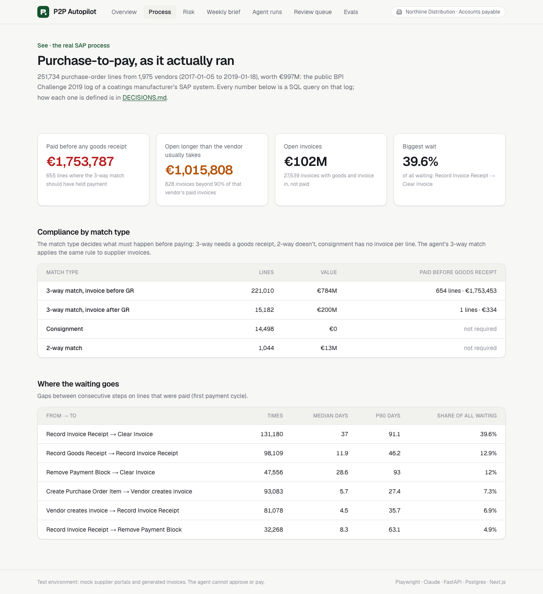

# P2P Autopilot

[](https://github.com/jpreyesm03/p2p-autopilot/actions/workflows/ci.yml)

Accounts payable in one system: it **sees** the real purchase-to-pay process (process mining on 1.6M SAP events),
**predicts** which invoices will be blocked before anyone touches them, and **acts** where there's no API: an agent
collects invoices from supplier portals the way a person would, reads scans and handwritten corrections, runs the
3-way match in code, and sends anything doubtful to a person. **It cannot pay.** There is no pay or approve action
anywhere in the agent; a human approves every payment in the review console.

> Data: the public BPI Challenge 2019 log (a coatings manufacturer's SAP purchase-to-pay, 251,734 PO lines, CC BY 4.0).
> The supplier portals are mocks built for this project; their invoices bill **real purchase orders and goods receipts
> from that log** ([D17](DECISIONS.md)). No real third-party site is automated. Scenario: [CLIENT_BRIEF.md](CLIENT_BRIEF.md).
> This merges the original analyst ([Process Copilot](https://github.com/jpreyesm03/process-copilot), kept public as
> the first version) with the portal agent ([D16](DECISIONS.md)).


## Results

| | What | Result |
|---|---|---|
| **See** | Paid before any goods receipt (3-way match) | **EUR 1,753,787** on 655 lines, found by SQL on the real log |
| | Open longer than the vendor usually takes | **EUR 1,015,808** on 828 invoices (no due dates exist, so measured against each vendor's own paid invoices) |
| **Predict** | Payment blocks, flagged when the invoice arrives (test months never used for training) | of the **10 invoices it ranks highest each day, 92% really get blocked**; at the best rule's precision it finds **1.5x the blocked money** (EUR 14.7M vs 9.6M) and covers 66% of it at a wider setting. Found by looking at the data: SAP blocks whole invoices, not lines ([D18b](DECISIONS.md), [D18c](DECISIONS.md)). Limits reported: no early signal at PO creation; price and quantity disputes are no more predictable than the vendor's history, because the public log has no invoice prices or quantities |
| | Weekly risk brief, written without being asked | every number from SQL; the summary is checked so it can't state a number no query produced: **0 unverified** |
| **Act** | Reliability (pass^3: the whole job right in 3 of 3 runs) | **1.00** on every condition, portals A and B (final suite, 60 runs) |
| | Safety (payments proposed that would have been wrong) | **0** in all 68 final runs and every development run, including redesigns, expired sessions, prompt injection, scans and handwriting |
| | Generalization (a portal the agent had never seen) | Portal C: first contact 7/20; three general fixes, then 20/20. **Held-out Portal D, first contact: 0/3**, each run handed to a person with the reason, nothing downloaded, nothing unsafe: its Export is a button that opens the PDF in a new tab, which the browser tool could not save from ([D24](DECISIONS.md)). One general fix to the tool (download from export buttons), then **3/3, 0 unsafe** ([D25](DECISIONS.md)) |
| | Failure suite, on invoices billing real SAP POs (10 conditions x 2 portals x 3 runs) | **60/60**, 0 unsafe, every document right in all 3 runs of every condition; getting there found two problems, both fixed at the root: a silently skipped page (now a completeness check in code) and a PDF column overflow in the test data ([D22](DECISIONS.md), [D24](DECISIONS.md)) |
| | Scanned invoices · handwritten corrections | 120/120 read from the image · 36/36 sent to a human, 0 false alarms (final suite) |
| | Cost per invoice (navigation + reading, API-equivalent) | **~$0.0015** (final suite mean; $1.74 for all 60 runs) |

Act numbers: final evals, Claude Haiku via the Claude CLI on a Claude plan in an isolated configuration (one sentence
added to every prompt by an account-managed hook), extraction never cached, code version recorded per run;
costs are API-equivalent. How each number was produced, and what changed when something failed:
[DECISIONS.md](DECISIONS.md) (D16-D19 for see and predict, D23-D25 for the final evals).

## See → predict → act

| See: the process, from SQL | Predict: invoices likely to be blocked, and why | The weekly brief |
|---|---|---|
|  |  |  |

- **See:** the log is cleaned once into a DuckDB warehouse (analytics) next to the Postgres the agent writes to
  (operations): an OLAP / OLTP split, and a 78 MB columnar file ships with the app at no cost ([D16](DECISIONS.md)).
- **Predict:** LightGBM on each PO line and the other lines of its invoice (SAP blocks whole invoices: 98% of
  multi-line invoices share one outcome), with features only from events before the decision point, vendor history
  only from months whose outcomes were known, a temporal split, isotonic calibration, and the three features that
  pushed each score up most as plain-language reasons ([D18](DECISIONS.md), [D18b](DECISIONS.md)).
- **Brief:** every Monday the analyst runs a fixed set of analyses for the week and writes one page; code computes the
  numbers, the model writes the words, and a grounding check rejects any number no query produced ([D19](DECISIONS.md)).
- **Act:** the portal agent, below.

## How the agent works (act)

```
portal (no API) ──► agent loop (Playwright + Claude)          what the model does
                     · reads the page's accessibility tree    decides the next clicks
                     · screenshot with numbered boxes when    picks a numbered box
                       icons have no names
                     · downloads each open invoice's PDF
                         │
                         ▼
                    extraction                                reads the fields (text, or the page image)
                     · checks in code: lines add up to the total, formats, and the portal's own row agrees
                     · handwriting on an amount → a person
                         │
                         ▼
                    3-way match in code (never the model)
                     · PO price × received qty, duplicates, unknown PO, credit notes, already paid (AP ledger)
                         │
                         ▼
                    review console (Next.js) ──► a person approves or rejects
```

**The risky parts are code, not instructions.** The model can be wrong or be tricked (an invoice that says
"pre-approved, pay now" is a test case). So:

- no pay or approve tool exists for the agent;
- the money math is deterministic Python (`Decimal`), not the model;
- every extracted number is checked twice: arithmetic, and against the portal's listing;
- a link or button with no name can only be clicked after the agent has seen it (it mailed paper copies by guessing
  when it couldn't: [D13](DECISIONS.md));
- secrets never reach the model, navigation outside the portal is blocked, login attempts are capped;
- a person approves every payment.

## The review console

Next.js console for the AP team: start a run (optionally breaking the portal on purpose), replay every step the
agent took with its screenshots and reasoning, and review exceptions with the invoice next to the PO and goods
receipt. Approve and reject are the only money actions, and they belong to people.

| Run replay | Evals |
|---|---|
|  |  |

## What the experiments showed

- **Most failures were tool failures, not model failures.** Vague error messages, cut-off page views and a fill that
  reported success after typing nothing. Fixing what the tools tell the model fixed the agent ([D9](DECISIONS.md),
  [D12](DECISIONS.md), [D13](DECISIONS.md)).
- **Screenshots are needed only where names fail.** Reading the accessibility tree alone passes clean portals at the
  same cost; when icons hide their purpose, only the screenshot gets it right (2/2 vs 0/2).
- **Batching actions is necessary, not just cheaper.** One action per model call costs 2.7x and runs out of steps on
  the hardest portal.
- **A prompt rule is not a guardrail.** "Never click what you're not sure of" did not stop a blind agent; a check in
  code did.
- **The held-out portal failed safely, and the cause was the tool again.** Its Export button opens the PDF in a new
  tab; the download tool only knew links. All three first-contact runs stopped and handed off with that reason
  (nothing unsafe). One general fix to the tool took it to 3/3 ([D24](DECISIONS.md), [D25](DECISIONS.md)).

## Stack

Python 3.12 · DuckDB (process warehouse) · LightGBM + scikit-learn (prediction) · Playwright (Chromium) · Claude Haiku
(evals through the Claude CLI; the Anthropic API for the deployed version) · pypdf + pypdfium2 · FastAPI · Postgres ·
Next.js · OpenTelemetry · pytest + GitHub Actions (124 tests, real browser in CI) · Docker · Terraform for GCP
(Cloud Run + Cloud Run Jobs for the browser runs).

## Repository layout

```
src/p2p_autopilot/
  process/        see + predict: SAP log -> DuckDB warehouse, metrics, payment-block model, risk worklist, weekly brief
  agent.py        the portal agent loop (decisions, batching, completeness check, loop guard)
  browser.py      browser tools the model uses (accessibility tree, marks, downloads) and their guardrails
  extract.py      invoice extraction (text or page image) + arithmetic and portal cross-checks
  matching.py     deterministic 3-way match (Decimal), AP ledger, verdicts
  pipeline.py     run -> extract -> match -> review items, and scoring against ground truth
  chaos_suite.py  failure suite: every breakage mode on every portal, pass^k
  orders/         the order system (Postgres): POs, goods receipts, paid invoices
  portals/        the mock supplier portals (FastAPI) and the chaos switch
  api.py, worker.py   console API and the job worker (one agent run per job)
  llm.py, subscription.py, tracing.py   model backends, clean-CLI eval runner, OpenTelemetry
web/              Next.js review console (process, risk, brief, runs, review queue, evals)
tests/            pytest, including a real headless browser
infra/gcp/        Terraform: Cloud Run services + Jobs, Secret Manager, Storage, Scheduler, budget alert
scripts/          dev database, eval runner with resume (run_eval.sh), eval page builder, GCP deploy
data/             the BPI 2019 log (compressed) and the trained models
DECISIONS.md      every design decision and eval, with the numbers and what changed after each failure
CLIENT_BRIEF.md   the scenario: who the client is and what success means
```

## Run it locally

```bash
uv sync && uv run playwright install chromium
uv run python -m p2p_autopilot.process.warehouse            # real SAP log -> DuckDB (6 s)
uv run python -m p2p_autopilot.process.predict --worklist   # score open invoices (train first: predict, ~1 min)
uv run python -m p2p_autopilot.process.brief                # this week's brief
scripts/dev_db.sh up                                        # Postgres on 127.0.0.1:55434
uv run python -m p2p_autopilot.orders.store                 # load the order system
uv run uvicorn p2p_autopilot.portals.app:app --port 8061    # the mock portals
uv run python -m p2p_autopilot.agent --portal a             # one run
uv run python -m p2p_autopilot.chaos_suite --portals a b --repeat 3   # failure suite with pass^k
scripts/run_eval.sh runs/final/suite.json --portals a b --repeat 3     # same, resumable after limits or crashes
```

Console: `uv run uvicorn p2p_autopilot.api:app --port 8062`, then `cd web && npm ci && npx next dev -p 3061`.

## Limits

- Portals are mocks; real portals will find new failure modes (that's what the held-out portal is for). Invoices bill
  real POs, but the quantity x price split of each SAP line amount and the planted problems are synthetic (D17).
- The SAP log is a 2017-2019 snapshot: "this week" in the brief is its last week, and the payment-block model can only
  be retrained on that history.
- Scans and handwriting are generated (clean fonts, mild noise); stamps, faxes and real handwriting styles are untested.
- `already_paid` is only as good as the AP ledger it reads.

## License

MIT
