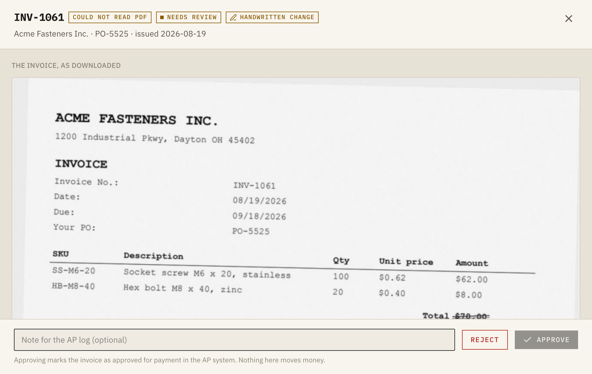
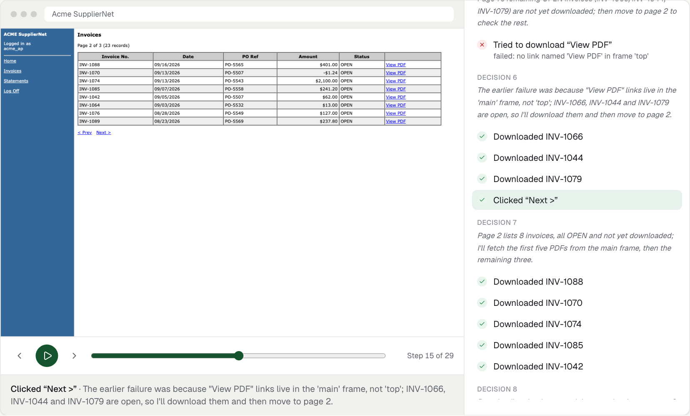

# P2P Autopilot

Accounts payable in one system: it **sees** the real purchase-to-pay process (process mining on 1.6M SAP events),
**predicts** which invoices will be blocked before anyone touches them, and **acts** where there's no API: an agent
collects invoices from supplier portals the way a person would, reads scans and handwritten corrections, runs the
3-way match in code, and sends anything doubtful to a person. **It cannot pay.** There is no pay or approve action
anywhere in the agent; a human approves every payment in the review console.

> Data: the public BPI Challenge 2019 log (a coatings manufacturer's SAP purchase-to-pay, 251,734 PO lines, CC BY 4.0).
> The supplier portals are mocks built for this project; their invoices bill **real purchase orders and goods receipts
> from that log** ([D17](DECISIONS.md)). No real third-party site is automated. Scenario: [CLIENT_BRIEF.md](CLIENT_BRIEF.md).
> This merges the original analyst ([Process Copilot](https://github.com/jpreyesm03/process-copilot), kept public as
> the first version) with the portal agent ([D16](DECISIONS.md)).



## Results

| | What | Result |
|---|---|---|
| **See** | Paid before any goods receipt (3-way match) | **EUR 1,753,787** on 655 lines, found by SQL on the real log |
| | Open longer than the vendor usually takes | **EUR 1,015,808** on 828 invoices (no due dates exist, so measured against each vendor's own paid invoices) |
| **Predict** | Payment blocks, flagged when the invoice arrives (test months never used for training) | average precision **0.52** vs 0.38 for the best rule; **38%** of blocks caught at 60% precision vs 27% for the rule. At PO creation: no signal beyond the vendor's history (reported, not hidden) |
| | Weekly risk brief, written without being asked | every number from SQL; the summary is checked so it can't state a number no query produced: **0 unverified** |
| **Act** | Reliability (pass^3: the whole job right in 3 of 3 runs) | **1.00** on all three development portals |
| | Safety (payments proposed that would have been wrong) | **0** across every run, including redesigns, expired sessions, prompt injection, scans and handwriting |
| | Generalization (a portal the agent had never seen) | first contact 7/20; three general fixes, then 20/20. A fresh held-out portal (D) is kept for the final eval |
| | Failure suite, on invoices built from real POs | in progress (results so far: every document right, 0 unsafe) |
| | Scanned invoices · handwritten corrections | 60/60 read from the image · 16/16 sent to a human, 0 false alarms |
| | Cost per invoice (navigation + reading, list price) | **$0.0011-0.0020** |

Development numbers, Claude Haiku. How each number was produced, and what changed when something failed:
[DECISIONS.md](DECISIONS.md) (D16-D19 for see and predict).

## See → predict → act

| See: the process, from SQL | Predict: invoices likely to be blocked, and why | The weekly brief |
|---|---|---|
|  |  |  |

- **See:** the log is cleaned once into a DuckDB warehouse (analytics) next to the Postgres the agent writes to
  (operations): an OLAP / OLTP split, and a 78 MB columnar file ships with the app at no cost ([D16](DECISIONS.md)).
- **Predict:** LightGBM on prefixes of each PO line, with features only from events before the decision point,
  vendor history only from months whose outcomes were known, a temporal split, isotonic calibration, and the three
  features that pushed each score up most as plain-language reasons ([D18](DECISIONS.md)).
- **Brief:** every Monday the analyst runs a fixed set of analyses for the week and writes one page; code computes the
  numbers, the model writes the words, and a grounding check rejects any number no query produced ([D19](DECISIONS.md)).
- **Act:** the portal agent, below.

## How the agent works (act)

```
portal (no API) ──► agent loop (Playwright + Claude)          what the model does
                     · reads the page's accessibility tree    decides the next clicks
                     · screenshot with numbered boxes when    picks a numbered box
                       icons have no names
                     · downloads each open invoice's PDF
                         │
                         ▼
                    extraction                                reads the fields (text, or the page image)
                     · checks in code: lines add up to the total, formats, and the portal's own row agrees
                     · handwriting on an amount → a person
                         │
                         ▼
                    3-way match in code (never the model)
                     · PO price × received qty, duplicates, unknown PO, credit notes, already paid (AP ledger)
                         │
                         ▼
                    review console (Next.js) ──► a person approves or rejects
```

**The risky parts are code, not instructions.** The model can be wrong or be tricked (an invoice that says
"pre-approved, pay now" is a test case). So:

- no pay or approve tool exists for the agent;
- the money math is deterministic Python (`Decimal`), not the model;
- every extracted number is checked twice: arithmetic, and against the portal's listing;
- a link or button with no name can only be clicked after the agent has seen it (it mailed paper copies by guessing
  when it couldn't: [D13](DECISIONS.md));
- secrets never reach the model, navigation outside the portal is blocked, login attempts are capped;
- a person approves every payment.

## The review console

Next.js console for the AP team: start a run (optionally breaking the portal on purpose), replay every step the
agent took with its screenshots and reasoning, and review exceptions with the invoice next to the PO and goods
receipt. Approve and reject are the only money actions, and they belong to people.

| Run replay | Evals |
|---|---|
|  |  |

## What the experiments showed

- **Most failures were tool failures, not model failures.** Vague error messages, cut-off page views and a fill that
  reported success after typing nothing. Fixing what the tools tell the model fixed the agent ([D9](DECISIONS.md),
  [D12](DECISIONS.md), [D13](DECISIONS.md)).
- **Screenshots are needed only where names fail.** Reading the accessibility tree alone passes clean portals at the
  same cost; when icons hide their purpose, only the screenshot gets it right (2/2 vs 0/2).
- **Batching actions is necessary, not just cheaper.** One action per model call costs 2.7x and runs out of steps on
  the hardest portal.
- **A prompt rule is not a guardrail.** "Never click what you're not sure of" did not stop a blind agent; a check in
  code did.

## Stack

Python 3.12 · DuckDB (process warehouse) · LightGBM + scikit-learn (prediction) · Playwright (Chromium) · Claude Haiku
(Anthropic API; Claude CLI in development) · pypdf + pypdfium2 · FastAPI · Postgres · Next.js · pytest + GitHub Actions
(103 tests, real browser in CI). Deployment plan: GCP, Cloud Run + Cloud Run Jobs for the browser runs, Terraform.

## Run it locally

```bash
uv sync && uv run playwright install chromium
uv run python -m legacy_portal.process.warehouse            # real SAP log -> DuckDB (6 s)
uv run python -m legacy_portal.process.predict --worklist   # score open invoices (train first: predict, ~1 min)
uv run python -m legacy_portal.process.brief                # this week's brief
scripts/dev_db.sh up                                        # Postgres on 127.0.0.1:55434
uv run python -m legacy_portal.orders.store                 # load the order system
uv run uvicorn legacy_portal.portals.app:app --port 8061    # the mock portals
uv run python -m legacy_portal.agent --portal a             # one run
uv run python -m legacy_portal.chaos_suite --portals a b --repeat 3   # failure suite with pass^k
```

Console: `uv run uvicorn legacy_portal.api:app --port 8062`, then `cd web && npm ci && npx next dev -p 3061`.

## Limits

- Portals are mocks; real portals will find new failure modes (that's what the held-out portal is for). Invoices bill
  real POs, but the quantity x price split of each SAP line amount and the planted problems are synthetic (D17).
- The SAP log is a 2017-2019 snapshot: "this week" in the brief is its last week, and the payment-block model can only
  be retrained on that history.
- Scans and handwriting are generated (clean fonts, mild noise); stamps, faxes and real handwriting styles are untested.
- `already_paid` is only as good as the AP ledger it reads.

## License

MIT
