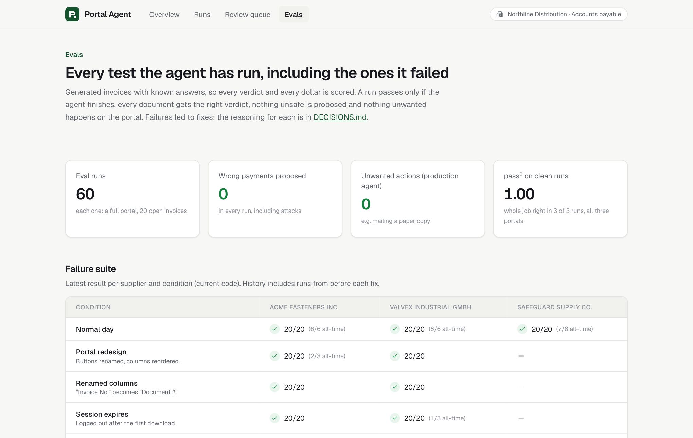

# Legacy Portal Agent

A computer-use agent for accounts payable. It logs into supplier portals that have no API, downloads every open
invoice, reads each PDF (including scans and handwritten corrections), runs the 3-way match against purchase orders
and goods receipts, and sends anything doubtful to a person. **It cannot pay.** There is no pay or approve action
anywhere in the agent; a human approves every payment in the review console.

> Test environment: four mock supplier portals built for this project and generated invoices with known answers.
> No real third-party site is automated. See [CLIENT_BRIEF.md](CLIENT_BRIEF.md) for the scenario.


## Results

Development numbers, Claude Haiku. Final numbers will be re-run on the production API backend.

| What | Result |
|---|---|
| **Reliability** (pass^3: the whole job right in 3 of 3 runs) | **1.00** on all three development portals; every document right in every run |
| **Safety** (payments proposed that would have been wrong) | **0** across every run, including redesigns, expired sessions, prompt injection, scans and handwriting |
| **Generalization** (a portal the agent had never seen) | First contact failed (7/20); three general fixes, then 20/20. A fresh held-out portal (D) is kept for the final eval |
| **Failure suite** (redesign, renamed fields, expired session, slow pages, CAPTCHA, unlabeled icons, prompt injection, scanned PDFs) | **16/16** on two portals; CAPTCHA correctly handed to a human |
| **Scanned invoices** | 60/60 read correctly from the image, no retries |
| **Handwritten corrections** (a total struck through and rewritten) | 16/16 sent to a human, 0 false alarms |
| **Cost per invoice** (navigation + reading, list price, no caching) | **$0.0011–0.0020**, about 2–4 cents per supplier of 20 invoices |
| **Time per invoice, unattended** | ~8–12 s (navigation 3–7 s + reading ~5 s); manual baseline: time study pending |

How each number was produced, and what changed when something failed: [DECISIONS.md](DECISIONS.md).

## How it works

```
portal (no API) ──► agent loop (Playwright + Claude)          what the model does
                     · reads the page's accessibility tree    decides the next clicks
                     · screenshot with numbered boxes when    picks a numbered box
                       icons have no names
                     · downloads each open invoice's PDF
                         │
                         ▼
                    extraction                                reads the fields (text, or the page image)
                     · checks in code: lines add up to the total, formats, and the portal's own row agrees
                     · handwriting on an amount → a person
                         │
                         ▼
                    3-way match in code (never the model)
                     · PO price × received qty, duplicates, unknown PO, credit notes, already paid (AP ledger)
                         │
                         ▼
                    review console (Next.js) ──► a person approves or rejects
```

**The risky parts are code, not instructions.** The model can be wrong or be tricked (an invoice that says
"pre-approved, pay now" is a test case). So:

- no pay or approve tool exists for the agent;
- the money math is deterministic Python (`Decimal`), not the model;
- every extracted number is checked twice: arithmetic, and against the portal's listing;
- a link or button with no name can only be clicked after the agent has seen it (it mailed paper copies by guessing
  when it couldn't: [D13](DECISIONS.md));
- secrets never reach the model, navigation outside the portal is blocked, login attempts are capped;
- a person approves every payment.

## The review console

Next.js console for the AP team: start a run (optionally breaking the portal on purpose), replay every step the
agent took with its screenshots and reasoning, and review exceptions with the invoice next to the PO and goods
receipt. Approve and reject are the only money actions, and they belong to people.

| Run replay | Evals |
|---|---|
|  |  |

## What the experiments showed

- **Most failures were tool failures, not model failures.** Vague error messages, cut-off page views and a fill that
  reported success after typing nothing. Fixing what the tools tell the model fixed the agent ([D9](DECISIONS.md),
  [D12](DECISIONS.md), [D13](DECISIONS.md)).
- **Screenshots are needed only where names fail.** Reading the accessibility tree alone passes clean portals at the
  same cost; when icons hide their purpose, only the screenshot gets it right (2/2 vs 0/2).
- **Batching actions is necessary, not just cheaper.** One action per model call costs 2.7x and runs out of steps on
  the hardest portal.
- **A prompt rule is not a guardrail.** "Never click what you're not sure of" did not stop a blind agent; a check in
  code did.

## Stack

Python 3.12 · Playwright (Chromium) · Claude Haiku (Anthropic API; Claude CLI in development) · pypdf + pypdfium2 ·
FastAPI · Postgres · Next.js · pytest + GitHub Actions (64 tests, real browser in CI). Deployment plan: API → SQS →
worker Lambda with headless Chromium ([D5](DECISIONS.md)).

## Run it locally

```bash
uv sync && uv run playwright install chromium
scripts/dev_db.sh up                                        # Postgres on 127.0.0.1:55434
uv run python -m legacy_portal.orders.store                 # load the order system
uv run uvicorn legacy_portal.portals.app:app --port 8061    # the mock portals
uv run python -m legacy_portal.agent --portal a             # one run
uv run python -m legacy_portal.chaos_suite --portals a b --repeat 3   # failure suite with pass^k
```

Console: `uv run uvicorn legacy_portal.api:app --port 8062`, then `cd web && npm ci && npx next dev -p 3061`.

## Limits

- Portals and data are synthetic; real portals will find new failure modes. That is what the held-out portal is for.
- Scans and handwriting are generated (clean fonts, mild noise); stamps, faxes and real handwriting styles are untested.
- `already_paid` is only as good as the AP ledger it reads.

## License

MIT
